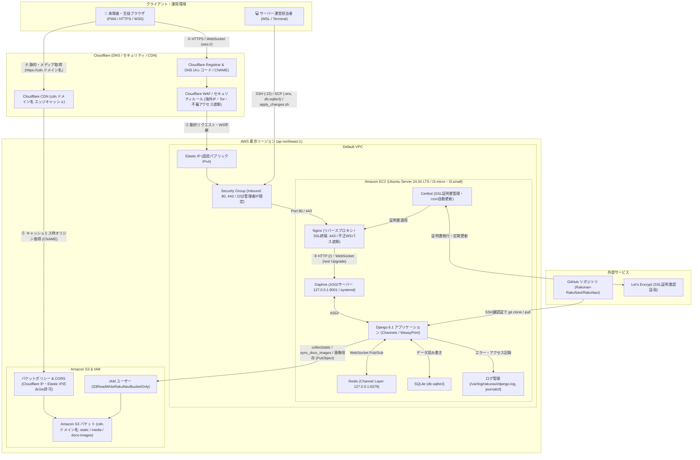

# RakuNavi (らくなび) — Portfolio Edition

[](https://www.python.org/)
[](https://www.djangoproject.com/)
[](https://channels.readthedocs.io/)
[](https://web.dev/progressive-web-apps/)
[](LICENSE.md)

学内文化祭・体育祭の運営と来場者体験を革新するために開発された、**リアルタイム学内ナビゲーションWebアプリケーション**です。

---

> [!IMPORTANT]
> **【ポートフォリオ公開およびライセンスに関する注記】**  
> - **公開目的:** 本リポジトリは、学生エンジニア選考およびポートフォリオ提出を目的として公開されています。
> - **機密保護:** 学内規約およびセキュリティ・プライバシー保護の観点から、実際の校内フロア図面・構内マップ画像、非公開座標データ、本番環境変数、生徒の個人情報・アップロードデータはすべて完全に除外またはモック／ダミーデータに差し替えてあります。
> - **ライセンスについて:** 本プロダクトは在校生・卒業生有志による共同開発プロジェクトであり、共同開発メンバー全員のOSS再配布許諾を未取得のため、**無断転載・再配布・商用利用・コード流用を禁止する厳格な閲覧限定ライセンス（All Rights Reserved）** を適用しています。採用選考における技術審査・コード評価の目的に限り、閲覧およびローカルでの動作確認を歓迎いたします。

---

## 📖 プロジェクト概要

「らくなび」は、数千人規模の来場者が訪れる学校文化祭・体育祭において、従来の紙パンフレットや看板だけでは困難だった「リアルタイムな混雑把握」「迷いやすい校内フロアのナビゲーション」「デジタル整理券の発行」を一手に担うWebシステムです。

生徒および来場者がスマートフォンからアプリのインストール不要（PWA対応）でスムーズに利用できる設計となっています。

### 主要機能
1. **インタラクティブ学内マップ**
   - フロア（地下1階〜地上4階、北館、野外ステージ等）ごとの教室配置・展示ブースを視覚的に表示
   - スポット（教室・ステージ）のタップによる展示詳細・タイムテーブルへのシームレスな遷移
2. **リアルタイム混雑度・待ち時間配信**
   - 各展示団体の生徒が専用トークン認証から最新混雑度（空き／普通／混雑／整理券状況）を即時更新
   - 来場者画面へ最新情報を瞬時に反映
3. **展示・パフォーマンス・模擬店タイムテーブル**
   - 時間枠ごとのステージ発表や模擬店アレルゲン情報の詳細表示
   - お気に入り・タグ絞り込み機能
4. **デジタル整理券システム**
   - 発行上限・時間帯枠ごとのリアルタイム受付管理
5. **ダークモード & PWA対応**
   - 屋内外での視認性を考慮したカラーテーマ切り替え
   - オフラインキャッシュおよびホーム画面追加対応

---

## 🛠 技術スタック

| 分野 | 技術 / ツール |
| :--- | :--- |
| **バックエンド** | Python 3.12+, Django 6.1, Django Channels (WebSocket), Daphne (ASGI) |
| **データベース** | SQLite (`db.sqlite3`) |
| **フロントエンド** | Vanilla JavaScript (ES Modules), Vanilla CSS (Flexbox / CSS Grid), HTML5 |
| **メディア・アセット** | Pillow (画像最適化・WebP変換), Google Material Symbols (サブセット化最適化), WeasyPrint (PDF出力) |
| **認証・管理** | Django Allauth, Django Baton (管理画面カスタマイズ), CKEditor 5 |
| **非同期・タスク** | Redis (Channel Layer), Django APScheduler |
| **インフラ（本番運用時）** | AWS EC2 (Ubuntu 24.04 LTS), Nginx, Let's Encrypt (Certbot), Cloudflare (DNS / WAF / CDN), AWS S3 |

---

## 🏗 サーバーインフラ構成

本番運用時は **Cloudflare**（ドメイン管理・WAF・CDN）と **AWS 東京リージョン (`ap-northeast-1`)**（EC2・S3・IAM）を組み合わせ、数千人規模の同時アクセスと WebSocket によるリアルタイム通信を低コストかつ安全にさばく構成を採用しています（詳細は [`docs/server_manual_1.md`](docs/server_manual_1.md) および [`docs/server_manual_2.md`](docs/server_manual_2.md) を参照）。



### インフラ構成のポイント

1. **Webサーバー & ASGIアプリケーション構成（Nginx + Daphne + Django Channels）**
   - リバースプロキシの **Nginx** が HTTPS（Port 443）を終端し、通常の HTTP リクエスト（`/`）と WebSocket 接続（`/ws/` の `Upgrade` ヘッダ付きリクエスト）を分け、systemd で常駐管理される **Daphne**（`127.0.0.1:8001`）へ転送します。
   - 不正な WebSocket スキャン（`/ws-*`, `/wsfapi` 等）は Nginx 層でステータス `444` により即時遮断し、アプリケーション層の負荷を防止しています。
2. **静的ファイル・メディアのオフロード配信（Cloudflare CDN + Amazon S3）**
   - CSS・JS（`static/`）、展示・CKEditor アップロード画像（`media/`）、管理画面ドキュメント用画像（`docs-images/`）はすべて **Amazon S3**（`cdn.ドメイン名` バケット）に集約し、CNAME で接続した **Cloudflare CDN** からエッジ配信することで EC2 インスタンスの負荷を大幅に軽減しています。
   - S3 バケットポリシーにより、読み取り（`GetObject` / `ListBucket`）は **Cloudflare の IP レンジおよび EC2 の Elastic IP からのみ許可**し、書き込み（`PutObject`）は専用 IAM ユーザー（`S3ReadWriteRakuNaviBucketOnly`）に限定しています。
3. **多層セキュリティ対策（Cloudflare WAF + Security Group + Certbot + Django CSP）**
   - **Cloudflare WAF:** 海外 IP（`ip.src.country ne "JP"`）やログイン画面へのマネージドチャレンジ、Tor ノード遮断により、辞書攻撃やボットアクセスをエッジで防御。
   - **AWS Security Group:** SSH（Port 22）は運営担当者のグローバル IP のみに制限。
   - **SSL/TLS & セキュリティヘッダ:** Let's Encrypt（Certbot + crontab 自動更新）による HTTPS 化に加え、本番デプロイ完了フラグ（`DEPLOY_DONE=True`）連動で HSTS・Secure Cookie・Content Security Policy（`SECURE_CSP`）を一括適用。
4. **デプロイ・運用ワークフロー**
   - 運営担当者はローカル（WSL 等）から `.pem` 鍵認証で EC2 へ SSH / SCP 接続し、GitHub からの SSH クローン・プル、`.env` や `db.sqlite3` の配置、`collectstatic` / `sync_docs_images` による S3 同期、および [`scripts/apply_changes.sh`](scripts/apply_changes.sh) による `daphne`・`nginx` サービスの一括再起動を行います。

---

## 💡 設計・アーキテクチャの工夫

- **徹底的な表示速度（PageSpeed / Web Vitals）改善:**
  - 全アイコン（約5MB）からアプリで使用しているアイコンのみを抽出・サブセット化（約120KBに軽量化）
  - 全ページ共通処理（テーマ・ポップアップ・モーダル）を単一モジュールにまとめ、直列 import 連鎖によるブロッキングを排除
  - 画像のWebP自動変換およびアスペクト比固定によるリフロー／CLS防止
- **INSERTオンリーの混雑度履歴設計:**
  - `Attraction` モデルは UPDATE ではなく INSERT でレコードを追加。時系列での混雑遷移のトラッキングと障害時のロールバック性を両立
- **セキュアな分散編集アーキテクチャ:**
  - 各展示ブースの生徒はログイン不要の安全なセキュアトークン（86文字以上のURLセーフトークン）経由で自団体の情報のみを即座に更新可能

---

## 👤 担当領域・貢献内容 (My Contributions)

本プロジェクトにおいて、初期のプロジェクト立ち上げ（Initial commit）からコア開発者の一人として参画し、**900件以上のコミット**を通じてデータモデル初期設計、フロントエンドUI/UXの構築、全面的なレスポンシブ対応、および編集体験の改善を主導しました。

### 1. プロジェクト初期立ち上げとデータモデル設計 (2024年5月〜)
- **基盤構築:** Djangoプロジェクトの立ち上げ、基本ディレクトリ構造、設定ファイル（settings.py）の初期構成を主導。
- **主要モデルの設計:**
  - 展示（`Exhibition`）、会場スポット（`Spot`）、野外ステージ・ライブ発表（`Performance`）、時間枠（`TimeSlot`）、混雑度（`Attraction`）の基本リレーション・フィールドを設計。
  - 初期マイグレーションおよび初期シードデータ（fixtures）の整備。

### 2. 全画面のフロントエンドUI/UX設計 & レスポンシブ全面対応
- **モバイルファーストなレイアウト設計:**
  - 当日スマートフォンで利用する来場者・生徒のユーザビリティを最優先し、トップページ、展示一覧、展示詳細、アクセス案内、体育祭プログラム等の主要画面すべてにおいてレスポンシブデザイン（CSS Flexbox / CSS Grid / メディアクエリ）を設計・実装。
  - 多様な画面幅（iOS / Android / PC / タブレット）におけるフォントサイズ、余白、画像アスペクト比の調整を徹底し、表示崩れゼロを達成。
- **ナビゲーションと操作性の強化:**
  - ドロワー型サイドメニューの実装および画面遷移時のUX改善。
  - スクロール連動のページトップへ戻る（backToTop）ボタンの実装。
  - 会場案内や展示トークン認証で多用される QRコード表示・モーダルUI のデザイン刷新。
  - 屋外（体育祭・野外ステージ）と屋内での視認性を両立するダークモード／ライトモード対応。

### 3. 検索体験（UX）の最適化
- **リアルタイム検索バーのUX改善:**
  - 多数の出展（クラス展示、クラブ発表、学年企画、模擬店等）の中から来場者が目的のブースを迷わず見つけられるよう、検索バーの入力応答性、クリアボタン、プレースホルダー、入力時のフォーカスアニメーション等を改善。

### 4. 展示・ライブ発表（Performance）の動的フォーム機能
- **動的フォームセットの実装:**
  - 野外ステージ等に出演する学生バンド・劇団が、演奏曲（`Song`）や出演メンバー（`Member`）をページリロードなしで自由に追加・削除・並び替えできる動的フォームUIを JavaScript（Fetch API）と Django Formset で実装。
- **画像プレビュー機能（カスタムウィジェット）の開発:**
  - 展示やライブ写真のアップロード時に、選択した画像を即座に画面上で確認できるカスタムファイル入力ウィジェット（`previewable_file_input`）を開発。
- **CKEditor 5（リッチテキストエディタ）の統合・スタイル調整:**
  - 生徒が展示紹介文を作成するリッチテキストエディタ（CKEditor 5）において、HTMLテーブルの枠線が表示されない問題の修正や、`.ck-content` スタイル隔離によるグローバルCSSとの競合解消を実施。

### 5. 体育祭（Sports Festival）アプリのフロントエンド実装 (2026年)
- 体育祭向け特設ページにおいて、プログラム表示、チーム（団）紹介、学年別・ブロック別対抗戦のレスポンシブカードUIを実装。

---

## 🚀 ローカル環境での起動手順

本リポジトリはダミーデータ生成コマンドを備えており、クローン後すぐに手元で動作を確認できます。

### 1. リポジトリのクローン
```bash
git clone https://github.com/<your-username>/rakunavi-portfolio.git
cd rakunavi-portfolio
```

### 2. Python仮想環境の構築と依存パッケージの導入
```bash
python -m venv .venv

# Windows の場合
.venv\Scripts\activate

# macOS / Linux の場合
source .venv/bin/activate

pip install -r requirements.txt
```

### 3. 環境設定ファイルの準備
```bash
# サンプル設定ファイルをコピー
cp .env.example .env
```

### 4. マイグレーションの実行
```bash
python manage.py migrate
```

### 5. ポートフォリオ用サンプルデータの投入
架空の校内スポット（Building A, Room 101〜、ステージ等）や展示サンプルデータを一括生成します：
```bash
python manage.py init_portfolio_data
```

### 6. 開発サーバーの起動
```bash
python manage.py runserver
```
ブラウザで `http://127.0.0.1:8000/` にアクセスすると、学内ナビゲーションアプリのデモ画面が表示されます。

---

## 📄 ライセンス

本リポジトリのソースコードおよび関連資産は **Proprietary (All Rights Reserved)** です。  
技術選考・採用評価に伴う閲覧・検証を除き、無断での複製、改変、再配布、商用利用、または派生プロダクトへの流用を固く禁じます。  
詳細は [LICENSE.md](LICENSE.md) をご参照ください。
