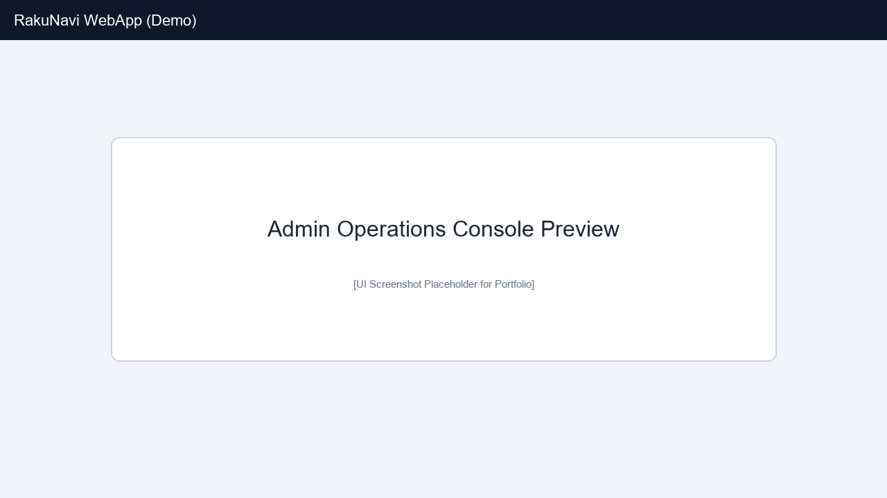

# 実運用事務マニュアル（文化祭・体育祭すべて）

対象：コンピュータ部員、運営者（高校生が望ましい）

    このマニュアルはプログラミングに疎くてもできる（はずの）、らくなび運用事務作業のマニュアルになります。
井﨑自身（以下私）、らくなびが24年度に成功裏に運営できた秘訣には、「先生方からの急な仕様変更要求に耐えた開発スピード」など技術面だけでなく、「校内での公式Webアプリとしての立ち回り」、「事務的作業やすり合わせの連続」があったと思っています。
そもそも、らくなびという名称は我々がつけた訳ではなく、私が中3の時2つ上の荒川氏が非公式で文化祭のために作ったサイトの名前です。これは非公式であるため学校側か ら発禁され、それに不満を抱いた私が宮崎先輩に協力要請し......　という流れな訳です。

さて、ひとまずらくなび運営に必要な事務作業についてまとめて行きましょう。

## Part 0 はじめに

#### 心構え

先生方や他生徒など利害関係者に対してどういった立場に置かれるか、以下を心に留めて下さい。
- 対先生方：一応はボランティア
  「文化祭補助生徒」の会合の場で木村先生が仰ったことですが、責任は大人（先生）が負うから僕たちは大人の方針に従うのが絶対です。我々はお金をもらって仕事をしているのではないので、この意味での責任は発生しません。同時に勝手に何かしていい、というわけではないので注意。
  `＊「文化祭補助生徒」：らくなびと同年度に発足した仕組みで、生徒が文化祭運営に積極的に関わり、先生方の仕事を若干減らす名目。生徒会などとは組織的に別で、らくなび開発者は補助生徒の役割に入ります。コンピュータ部以外で関わるメンバーは加入のこと。`
- 対展示・ライブ等の生徒
  コンピュータ部員の場合は特に、運営者として上級生へ説明を行うわけですから丁寧さと落ち着きが求められます。一般生徒にしてみても、中学生にとやかく指図されるのは癪に障ることがあるかも知れませんから。

#### 理解すべきワード・フレーズ
words&phrases_U_should_know.mdにまとめています。必ず確認したほうがいいですヨ。 

## Part 1 顔合わせ

４月新年度に役割を確認して、本格化するのは７月の期末考査後。我々はすぐ動き出します。先生方（ホームページ担当？）と集会を持って今後の流れを確認します。
例：
1. 昨年からの変更・要望
2. 審査・入力締め切りなどのスケジュール
3. ９月１日展示説明会で必要なものの確認
4. 引き継ぎなど
5. （開発側がサーバーの建て替えを完了していれば）教員用アカウントを渡す
   これは審査で使用するアカウントで、`Django管理サイト＞管理設定＞ユーザー` 配下で、対象が`スタッフ権限`にチェックの上、グループから`教員用ユーザー`が選択されていることを確認して下さい。

## Part 2 夏休み前〜説明会用意まで

#### Step 1 顔合わせで確認した書類を用意します。

夏休みに入る前に、下リストで必要な情報をできるだけ収集しましょう。

#### Step 2 データ更新
開発側でサーバーの建て替えが完了したら、DBのデータを更新します。入手がまだの情報は後になりますし、後で他と同時進行で行うことになる可能性もあります。

サーバーで管理サイト（/admin/）へスーパーユーザーでログインできることを確認します。

A：まず公開設定を確認します。今は準備中で、未公開に設定したいので

   ` Django管理サイト＞管理設定＞権限管理`　で`ホームの表示`と`「紹介ページの表示」` 、`「体育祭ページの表示（一括）」
` のチェックを外して保存します。
   `ホームを表示`ではホーム、スローガン一覧ページ、`紹介ページの表示`ではその他のページの公開/非公開を制御します。非公開の場合、Coming_Soonページ（/coming_soon/）にリダイレクトされます。

B：次に管理サイトで、以下のデータを年度に合うよう更新しましょう。必要なデータが無かったり分からなければ先生に依頼・相談します。必要なものが出揃うまで、2学期になっても継続しましょう。
	一部は、DBに１つしかオブジェクト（データ）が入らないようになっているものもあリます。その際データを追加しようとするとエラーになるのでお気をつけて。

###### 文化祭（3以外`管理設定`か`文化祭`いずれかにある）
1. 開催日
2. スローガン・キーアート
   スローガンは２学期になってから生徒会が決定すると思います。キーアートは美術部などに依頼しましょう。先生を通じて公募するのもありです。
3. マニュアル
   リポジトリの`docs/manuals_for_students/` フォルダ以下にある生徒用マニュアル（展示用、ライブ用、模擬店用）を適宜更新しましょう。DBの更新こそ必要ありませんが、文書の日付や文言、追加の規制が恐らく更新の対象になるでしょう。コンテンツ編集者は、後述の認証QRコードを使用して編集ページにアクセスすれば、ページ上のリンクからマニュアルを閲覧できます。
   フォルダ内のMarkDownファイル（*.md）を表示するロジックなので、各々のファイル名は変えても構いません。しかし、画像には対応していません。
5. ヘッダー等の写真
	無理に毎年変更する必要はありません。写真部に依頼してみてもいいかも知れませんが、**著作・肖像権には充分注意して下さい。** 東寺の画像も一応許可を取っています。
6. クレジット
   これまでの開発者の分もあるか確認して下さい。
7. ニュース
   ホームのFAQコーナーに表示される内容です。優先順位が高い（値が小さい）ほうが上に来ます。ホームの下の方に表示されます。

###### 体育祭（1以外`体育祭`）
1. 体育祭スローガン・開催日
	`管理設定` にあります。年度や開催時刻、スローガン等を設定しましょう。
2. 学級マスタ
   すべてのクラスが揃っているか確認して下さい。なければ追加、不要なものは削除しましょう。
	   一切のデータが存在しない場合、自動で作成できます。
	   例：`python3 manage.py init_school_classes --counts 7 7 7 9 9 9`
	   `--counts` 以降は無くてもいいですが、中1から高3まで順に、作成するクラスを半角数字で指定します。（例では中学7クラス、高校9クラスずつ）
3. プログラム
   Track_imageはトラックをどのように使うか、スタート地点などが載っている画像を掲載することを想定しています。体育科が作るそうで、直前にならないと入手できないかも知れません。ただ、必要だという要求はしておいて下さい。
4. 会場案内の説明文・会場案内画像
   会場案内画像も直前まで入手できないかも知れません。
5. 応援団
   それぞれの色に対して、所属するクラスや説明を設定します。説明文は各応援団に依頼します。これにあたっては、２学期になってから、文化祭と同様のフォーム入力システムを利用します。
6. 近鉄電車特別ダイヤ
   これは直前でないと分かりませんね。
7. 近鉄電車に関しての説明
	その年に近鉄電車による対応があるのかどうか、またその説明を記述します。アクセスページに表示されます。6のダイヤを表示するかも設定します。
8. 学年色
   プログラムページなどで学年の色をデザインに使用するので、その色です。学年カラーに近い色に合わせて下さい。
9. 一般画像
   背景画像などです。

#### Step 3 展示・ライブ・模擬店DBを初期化

また夏休み終了までに管理ページ（Django管理サイトとは違う、フッタ―にあるもの）で展示・ライブ・模擬店等を初期化します。

先立って、確認事項が数点あります。

1. （開発者と協力して）リポジトリの`docs/展示一覧表.xlsx`を確認します。**その年度のクラス、クラブ、学年展示、施設・その他の編成を反映**しましょう。クラスのシートにおいて、2学期になっていないので模擬店の「あり・なし」が不明となりますが、ここは確定してからで大丈夫です。上書き保存を忘れずに。
2. 次に、Django管理サイトで`管理設定＞💾デフォルトオブジェクト数`を確認しましょう。この値はプリントの出力枚数を設定します。ライブは展示と異なり、事前に用意するプリントの数が分からないので、余裕を持った数が設定されているか確認します。

確認が終わったら、管理ページにおいて、`説明会資料 PDF のダウンロード`へ行って下さい。初期化を行うだけなら、プリント配布日などの設定は適当で構いません。プリント配布日と編集期限は、出力されるPDFに印字されるための値なので、もしここで間違えたからといって心配する必要もないです。DBに変更が行われるのは初期化を押したときのみで、変更がなければ、何度PDF出力ボタンを押しても同じPDFが出力されます。

忘れず展示・屋外ライブ・音楽室ライブそれぞれに初期化を行いましょう。（模擬店は2学期になってから行う）
PDFが出力されたら、必ずアクセスできるか確認して下さい。ここで` Django管理サイト＞管理設定＞権限管理` で許可していないと「アクセスが拒否されました。」とエラーが出るはずです。気をつけて。

## Part3 ２学期はじめ

#### 文化祭補助生徒集会
例年9月中旬？にあります。皆さんもらくなびに関わるなら応募して下さい。例年補助生徒には、地図やキッチンカーなどのデータ更新をお願いしてますが、今後はコンピュータ部内で人材が足りないようなら人材を獲得して下さい。

#### 展示説明会
例年9月1日、展示説明会があります。そこで我々がらくなびの紹介と展示に対してフォームの入力を要請する必要があります。**事前に先生にPDFを渡して印刷**しておいて下さい。これを説明会が始まる際に配布し、出席者にはiPad持参を事前にお願いしましょう。

説明会前に、`Django管理サイト＞管理設定＞権限管理`で`展示紹介ページの編集を許可` と`展示紹介ページの編集を許可（当日入力用）`にチェックを入れましょう。

##### アクセス制御の内部仕様
これは展示に限らず全てで共通ですが、らくなびの内部処理では、コンテンツ編集者を判別するのに、
**A：QRコードの示す展示と認証情報が合致している
B：`Django管理サイト＞管理設定＞権限管理` 以下の編集を許可する設定にチェックが入っている**
**AかつB**を満たす必要があります。
Aの認証状態はURLに埋め込まれていますが、それはアクセス後に消去され、代わりに**ブラウザを閉じるまで**、ブラウザに保存されます。そのためURLをブックマークしても認証状態が維持されるとは限りません。

説明では、用意したマニュアルをらくなび上からアクセスしてもらい、同時に読み上げるだけでもいいですが、説明スライドショー等を用意するのがベターです。らくなび上でマニュアル一覧は各編集ページ上のリンクからアクセスできます。URLで`management/manuals_for_students/` に直接アクセスもできますが、事前にQRコードを読んで認証が必要です。
また、**配布プリントを読み込んでもらい、編集ページにアクセスできることを確認します。** さらにお試しで当日入力用の混雑度フォームも送ってもらいましょう。

**説明会で重要なことは、コンテンツ審査基準を明確に発信することです。過去却下された例を挙げ、動画や画像、説明文で著作権などに充分気をつけるように伝えて下さい。**

できればここで、模擬店をする場合もらくなびにフォーム提出が必要だと伝えて下さい。
―説明会が終了したら、`展示紹介ページの編集を許可（当日入力用）`のみチェックを外し、あれば`文化祭>🇦展示用当日設定🚩`のオブジェクトをすべて削除して下さい。

#### 体育祭関連
今までで更新できなかったデータを取得しましょう。
各団の担当者に説明文を書いてもらうようにお願いします。
	応援団紹介文を依頼・回収する手順
1. `Django管理サイト＞応援団` ですべての応援団が揃っているか確認（ない場合は作成）
2. 体育祭ページのブロック一覧ページをスーパーユーザーアカウントで開き、ヘッダの下にある`PDFダウンロード` ボタンを押し保存（生成されるまで少し時間がかかるため辛抱強く待とう）
3. `Django管理サイト＞管理設定＞権限管理`　の`[体育祭]応援団ページ編集を許可` にチェックを入れ保存
4. 生成されたPDFのQRコードでアクセスできるか確認
5. 編集期限を先生と協議して決定、PDFの空欄に書き込む
6. 担当の先生を通じて各応援団に印刷したPDFを配布
7. 進捗を伺いつつ、期限に`Django管理サイト＞管理設定＞権限管理`　の`[体育祭]応援団ページ編集を許可` のチェックを外し締め切る（これ以降はQRコードを読み込んでも編集できなくなる）
8. 先生による審査、個別に修正があれば対応

#### ライブ説明会（オーディション）
オーディションにもお邪魔して同様のことを行います。
事前に管理ページに行き、PDFを作成、先生に頼んで印刷します。
説明会前に、`Django管理サイト＞管理設定＞権限管理`で`ライブ紹介ページの編集を許可`にチェックを入れましょう。**編集ページにアクセスできるか確認します。**
説明会に欠席の出場組（恐らく吹奏楽部のみ）には個別にプリントを配布します。

#### 模擬店集会
模擬店をするか決めるのは展示説明会後になることが多いので、別途集会の際にお邪魔して下さい。展示・ライブ同様に行って下さい。
PDF出力の際、以前Part2-Step3で後回しにしていた模擬店DBの初期化を忘れないで下さい。

#### 提出期限の設定
それぞれの説明会が終わったら、提出期限を設定します。ここで期限を設定すると、その時刻に自動的に`Django管理サイト＞管理設定＞権限管理` が変更され、スーパーユーザーと審査ユーザー以外のアクセスを制限します。すげえだろ。
`Django管理サイト＞管理設定＞権限管理`　に行き、`スケジュールされた変更（展示/模擬店/ライブ）` に期限を設定し、 `スケジュールするに` もチェックを入れます。ここにチェックがないと、期限になっても変更がトリガーされません。

#### データ更新
Part 2-Step2で行ったデータ更新の続きで、2学期になって入手できた情報があれば、必ず更新しましょう。
また追加で、地図やキッチンカーのデータ更新を行う必要があります。
##### 場所データ（地図）
来場者向けの地図において、洛南は1年毎に教室の配置が大きく変わるので位置を更新する必要があります。セキュリティの観点から、地図は来場者のみ表示できるように要請されています。よってログインしているユーザー以外は、校内掲示の合言葉を入力する必要があります。合言葉は`Django管理サイト＞管理設定＞権限管理＞Mapを見るための合言葉` にあります。先生とも相談してその年の合言葉を決めて下さい。ログインしているユーザー（管理者、先生、補助生徒など）以外の閲覧者は、正しい合言葉を入力することで文化祭終了時刻まで地図を閲覧できます。（ブラウザを閉じても認証状態は維持される）なお、合言葉が一致しても`開催日` より後であれば閲覧できない仕様です。
データ更新には、`Django管理サイト＞文化祭＞場所`　を操作します。展示生徒は、入力フォームで自分の展示と場所を紐づけているので、**場所の名称は変更しないこと**。 基本、階・Start_x, Start_y, width, heightを変更します。
階は自明として、Start_xは地図におけるX座標（横）、Start_yはY座標（縦）の割合（％）を表します。_なお左上が0で、X軸は右向きに＋、Y軸は下向きに＋になります。_ 
	例えば(Start_x, Start_y) = (12, 88)なら、その教室は地図の左下の方に表示されます。
width, heightは横、縦の長さを全体に対して％で表します。デフォルトはwidth=7, height=14です。

値を更新したら、適宜地図ページで場所を確認して微調整しましょう。

##### 青春の広場の地図更新
青春の広場の地図は他の地図と異なり、画像ファイルを直接表示します。よって年度ごとに更新が必要です。
`Django管理サイト＞文化祭＞青春の広場の地図` へ行き、それぞれの日にちの地図を更新します。
	地図ページで画像の更新が確認できたら成功です。

###### キッチンカー
キッチンカーの情報も更新します。まず`Django管理サイト＞文化祭＞キッチンカー`　からキッチンカーを作成し、`Django管理サイト＞文化祭＞メニュー`　からメニューを紐づけて作成します。紹介文と画像はなしでもOKです。

これらの更新作業を補助生徒に任せる場合、補助生徒用アカウント（１つでよい）を作成して渡しましょう。アカウント作成の際、`スタッフ権限` にチェックを入れ、ユーザーパーミッションには変更を許可するDB項目を選択して下さい。
	例えば以下のようになります。
		

#### ＊こんな時は
##### PDFの紛失
プリントを再度渡す前に、セキュリティのため、PDFに含まれる認証情報：トークンを再設定する必要があります。
	`Django管理サイト＞文化祭＞展示/ライブ/模擬店` から対象を選び、チェックボックスをつけて左上の`操作` から`--のトークンをリセットする` を選択し、`Run` で実行します。
終われば、以前の手順通り、PDFを生成して印刷して渡すだけです。

#### 既知の問題
- 複数のコンテンツの同時編集ができない
	認証情報であるトークンを認証後にブラウザに一時的に保存するため、「1-1の展示を編集しながらクラブ展示を編集する」とか「クラブ展示編集しながらライブを編集する」ことはできません。実際両方編集ページには到達できますが、再読み込みや保存時にアクセスが拒否される可能性があります。これは同時編集をそもそも想定していないからです。
	複数編集する必要がある際は、「1-1の展示を編集し保存後、クラブ展示のQRコードを読み編集する」ように並行して作業しないで下さい。

### 体育祭　本番に留意すること
`応援団` に得点を入力でき、優勝なども表示できるシステムがあるので、体育祭暇があれば（リアルタイムでなくて構わない）
反映させること。

## Part 4 審査
ここが少しややこしいです。各々の編集期限が終了したら、先生方のタイミングで審査会が行われます。我々が基本出席する必要はありませんが、トラブル対応や質問対応をしなければいけない可能性があるので、留意しておきましょう。
Part1で先生側に審査用のユーザーIDとパスワードを渡してありますが、紛失があれば再発行しましょう。基本先生方は１つのアカウントを使いまわします。（これによって処理で不具合が起こることはない）

1. 審査が終われば呼ばれると思うので、対象のコンテンツの審査が全て終わっているか管理ページで確認した後、
できれば職員室の先生のPC（審査用アカウントでログイン済み）で管理ページへアクセスし、`審査結果PDFのダウンロード` のセクションで対象のPDFを出力して下さい。編集期限は事前に協議した２ないし３回目の締切日に設定します。なお、この日付はPDFに印字されるためだけに使用され、ダウンロードボタンを押してもDBに変更は行われません。ご安心を。

2. PDFのQRコードから再び編集ができるように、`Django管理サイト＞管理設定＞権限管理` から`〜の編集を許可` にチェックを入れ保存しましょう。

3. QRコードに印刷されたQRコードを試しに１つスキャンし、編集できるか確認して下さい。編集できなければ、2が上手く設定できていません。

4. 1でダウンロードされたPDFを印刷（先生のPCから職員室の印刷室が良さそう）し、展示・模擬店なら各クラス担任や顧問に配布を要請し、ライブは放送で担当者を呼び出すのが良いでしょう。

5. 担当者への説明では、新しい編集期限を伝えましょう。アップロード方法に不安があるようなら対応してあげて下さい。またQRコードは説明会で配布したものも使い回し可能であると、必要なら伝えて下さい。

**全ての審査が終わるまで、展示・ライブ・模擬店にあたって1.から5.を繰り返します。**
審査は文化祭の数日前、例年通りなら10月入るまでに終了すると安心です。

#### 審査の仕様（2026年3月末時点）
編集ページへのアクセス制御の内部仕様はPart3の展示説明会のセクションで解説しています。
1. PDFは紛失して認証情報をリセットしない限り、同じQRコードが使用可能
2. `権限管理` で設定した編集期限に自動的に編集不可になり、専用エラーページにリダイレクトされる。
3. 再編集の期間になったり、手動で`権限管理` を変更すると、再度変更可能になる。
4. **（重要）** 再編集の期間では、編集を送信したら以前のステータスは自動的に更新され「審査待ち」に変更される。なお、既に審査に合格した展示も編集ができる。（今後変更の可能性）

## Part 5 公開・テスト・当日運用
#### 自動公開
審査が終了し、公開をいつにするかを協議します。決まったら、`Django管理サイト＞管理設定＞権限管理` から`## スケジュールによる変更（公開・当日設定）` で変更する日時を入力し、`上の日時での公開をスケジュールする` にチェック を入れて保存して下さい。これによって、指定した日時に自動的に権限管理の部分が変更され、公開が可能になります。
当日編集のところは、文化祭初日の開催時間にセットし、同じくチェックを入れ保存しましょう。

#### テスト
**この時点でもう一度、[Part2 Step2・Part3 データ更新]のデータの更新が全て完了しているか確認しましょう。**
できれば補助生徒やコンピュータ部のメンバー総出で、画面に穴が開くほどしっかり確認しましょう。

当日までの最後は、テストになります。想定どおりに全てのページが動作してるか確認しましょう。
当日用QRコードの動作確認
	当日用テストには、PDFから適当な展示のQRコードを読み取り、実際に値を変更してみましょう。
	テストが終了したら、忘れず`Django管理サイト＞文化祭＞展示用当日設定` に行き全てのオブジェクトを選択して「操作」から削除を実行しましょう。
地図の動作確認・張り紙設置
	ログインした状態で地図にアクセスし、場所に被りや表示におかしいところがないか確認して下さい。異常あればPart3の`データ更新＞場所データ` を参照して修正して下さい。
	次にログインしていなくても、合言葉を入れれば地図機能にアクセスできるか確認して下さい。
	地図は`Django管理サイト＞管理設定＞権限管理`　にある`紹介ページの表示` にチェックがあり、入力された合言葉が正しければ閲覧できるはずです。（ログインしたユーザーは常に閲覧可）
	確認が完了したら、一般の方や洛南生が校内地図を閲覧できるようにするため、合言葉とらくなびのQRコードを掲載したプリントを先生に作成・印刷してもらい、校内の適切な位置（階段横・エントランスとか）に貼り付けて回って下さい。補助生徒活用がいい。

#### 数日前
例年、展示の当日の混雑度入力が滞りがちなので、担任通じて、もしくは直接行って入力を促して下さい。

#### 当日
上手く行けば（バグや設定不具合がなければ）、当日特別何かすることはありません。混雑度の催促は必要かもしれませんが、バグや異常が無いかを定期的に確認する程度でOKです。文化祭楽しめ。

## Part 6 反省と引き継ぎ
#### 反省
出発から当日までにどんな問題点があったか、解決策や今後改善できそうなことを挙げておきましょう。

#### 引き継ぎ
次年度引き継いでもらう人材に、仕事のやり方やエッセンスを教えましょう。

##### リダイレクト設定
新しいサーバーの運用に入ったら、既存のURLを新しいドメインへリダイレクトする必要があります。
`Django管理サイト＞管理設定＞🤝新ドメイン移行用URL設定` にアクセスし、新しいドメインのURLを正しく入力します。確認したら`移行シークエンスの状態` にチェックをつけて保存します。成功すれば以降のアクセスから、新しいドメインに永久的にリダイレクトされます。（HTTP301）こうなるとWebでは既存のページにアクセスできなくなリます。**よって、この操作はサーバーの移行作業が完了してから注意して行ってください。**
もし失敗した場合やなにかの理由でリダイレクトを取り消したい場合、仮想環境上で`python3 manage.py disable_domain_redirect` と実行すればDBが書き換えられます。ただブラウザやCDNにキャッシュが残りリダイレクトの解除が行われない可能性があるので、それは随時調べてやってください。

**井﨑祐介**
